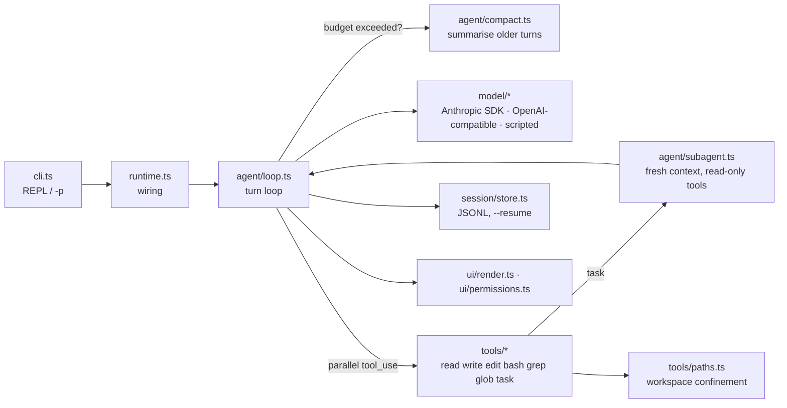

# quill

**Landing page:** https://quill-site-seven.vercel.app (replays the real demo output; scripted model)
**Live demo:** none. quill is a command-line tool with no hosted backend.

A small terminal coding agent in TypeScript (Bun), in the spirit of Claude Code, Codex CLI and
[pi](https://github.com/earendil-works/pi). It runs a real tool-using loop against a model, streams
the output, and manages its own context window: it summarises older turns when the budget fills up,
truncates huge tool output, and lets the main agent delegate investigations to parallel sub-agents.

The hard part is context engineering. Any agent can call tools in a loop; the interesting problem is
what happens when the transcript outgrows the budget. quill compacts by cutting only at assistant
messages, so every `tool_use` keeps its `tool_result` and the provider never sees a broken pairing.
That invariant is checked in the code and in the tests, not assumed.



## Quickstart

Requires [Bun](https://bun.sh) 1.3+. No API key is needed for the demos or the tests.

```bash
bun install
make test              # 80 tests: loop, tools, path confinement, compaction, sub-agent fan-out, sessions
make demo              # keyless: agent finds and fixes a bug in a temp repo, tests go red -> green
make demo-compaction   # keyless: four requests under a 1200-token budget; compaction triggers
```

Real model usage:

```bash
cp .env.example .env          # set ANTHROPIC_API_KEY
bun src/cli.ts                # interactive REPL in the current directory
bun src/cli.ts -p "add a test for parse()" --yes   # one-shot, auto-approve writes and bash
bun src/cli.ts --resume       # continue the latest session in .quill/sessions
```

Other providers: set `QUILL_OPENAI_BASE_URL` (and `QUILL_MODEL`, `QUILL_OPENAI_API_KEY` if needed)
to use any OpenAI-compatible server such as Ollama, OpenRouter or Groq. Anthropic wins when both are set.

Useful flags: `--context-tokens N` (compaction budget), `--max-tool-chars N`, `--max-turns N`,
`--workspace DIR`. Put project rules in `AGENTS.md` at the workspace root and they are added to the
system prompt.

## Design decisions and trade-offs

- **Provider-neutral transcript.** Messages are `text | tool_use | tool_result` blocks. Each adapter maps
  them to its wire format at the edge (`model/anthropic.ts`, `model/openai.ts`). The agent never imports an SDK.
- **Compaction cuts at assistant messages.** quill keeps the last two assistant turns verbatim (with their
  results) and the latest user request, and summarises everything older into one user message. Cutting at
  user turns instead would make a single long turn impossible to compact. `checkPairing()` verifies the
  invariant after every compaction in the tests and in the demo.
- **Compaction is decided before the call.** Usage is estimated at about 4 characters per token. The provider's
  reported usage is recorded per turn, because the decision has to be made before the request is sent.
- **Tool output is truncated, not dropped.** Each result keeps its head and tail, with a marker showing how much was cut.
- **Parallel tool calls.** All `tool_use` blocks from one assistant message run through `Promise.all`, and
  results are returned in call order. Permission questions go through a queue, so prompts never interleave.
- **Sub-agents are one level deep.** A `task` child starts with an empty history, gets only read-only tools,
  denies all permission requests, and returns only its final text. Children do not get the `task` tool, so
  recursion is impossible. The parent transcript stays small however much the child reads.
- **Confinement is checked on every path.** `resolveInside()` rejects `..`, absolute paths outside the root,
  NUL bytes, and symlinks that point outside. Dangling symlinks are rejected too, because writing through one
  would create a file at an unchecked target. Grep and glob never follow symlinks found during a walk; a symlink given as the grep path is allowed when it resolves inside the workspace.
- **Sessions are append-only JSONL.** A compaction record snapshots the compacted history, so `--resume` replays
  the snapshot and never re-runs the summariser. A torn last line from a crash is dropped on resume.
- **Permissions.** `write`, `edit` and `bash` need approval. Interactive mode asks; `--yes` approves; without a
  TTY and without `--yes`, they are denied and the model is told why.

## Verification

- Landing page: `site/` is static HTML, CSS and JS. `scripts/record-demos.ts` regenerates its replay data from `make demo` and `make demo-compaction`.

- `make test`: 80 tests across 14 files, run with `bun test`. Coverage is 89% of lines and 85% of functions (`bun test --coverage`). The tests are
  hermetic. The Anthropic streaming path runs through the real SDK against a local mock SSE server. The
  OpenAI-compatible path uses a fake `fetch`.
- `make demo`: the real loop and real tools, driven by a scripted model. The agent delegates a repo map to a
  sub-agent, reads the failing test and code in parallel, runs `bun test` (fails), edits the off-by-one, and
  re-runs it (passes).
- `make demo-compaction`: a 1200-token budget; one compaction fires on the fourth request and each
  snapshot stays pairing-valid.

## Limitations and next steps

- **Live-model runs are not verified in this repo.** The adapters are tested against a mock SSE server and a
  fake fetch, not a real API. Run `bun src/cli.ts -p "..."` with a key to exercise the live path.
- **`bash` is not a sandbox.** Confinement covers the file tools only. A shell command can still reach outside
  the workspace, so the approval prompt is the guard. Next step: run bash in a container or with
  `sandbox-exec`.
- **Token estimates are heuristic.** A 4-characters-per-token estimate can be off, especially for code and
  non-English text. Next step: calibrate it against the provider's reported `usage`.
- **A single turn can still overflow.** Compaction only runs at assistant boundaries, so a single request that
  exceeds the budget on its own is reported as a warning, not split further.
- **OpenAI-compatible path is non-streaming.** The full reply arrives at once.
- **Summaries are model-written.** Summaries can drop detail. Compaction keeps the last two exchanges verbatim
  and the current request, but earlier facts depend on the summary being faithful.
